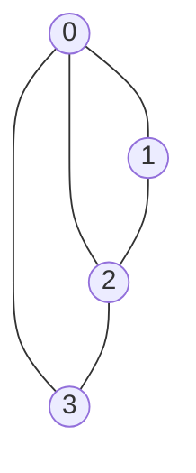
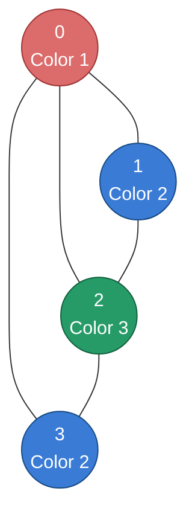
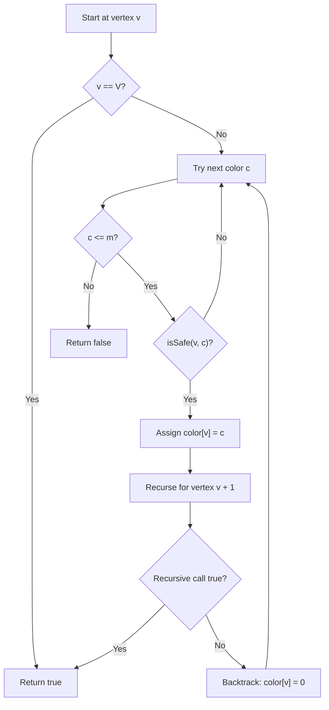

# Graph Coloring (M-Coloring)

**Topic:** Backtracking  
**Graph representation:** Adjacency Matrix

## Problem
Can every vertex of an undirected graph be assigned one of at most `m` colors so that adjacent vertices have different colors?

## Example graph

Adjacency matrix (`1` = edge, `0` = no edge):

```text
    0  1  2  3
0   0  1  1  1
1   1  0  1  0
2   1  1  0  1
3   1  0  1  0
```

The same graph as a diagram:



Edges: `0-1, 0-2, 0-3, 1-2, 2-3`.

## Valid coloring with 3 colors



| Vertex | Color |
|---:|---:|
| 0 | 1 |
| 1 | 2 |
| 2 | 3 |
| 3 | 2 |

**Why are 2 colors not enough?** Vertices `0, 1, 2` form a triangle: every pair is adjacent, so they must all have different colors. Therefore, at least 3 colors are required.

## Backtracking logic

1. Start at vertex `v` with all colors set to `0` (`0` means uncolored).
2. Try each color from `1` to `m`.
3. `isSafe()` checks whether any neighbour already has that color.
4. If safe, assign it and recurse to vertex `v + 1`.
5. If the recursive call fails, reset `color[v] = 0` and try the next color.
6. If `v == V`, every vertex has been colored successfully.

### Flow of recursion



## Important methods

- `isSafe(v, graph, color, c)`: Returns false if a neighbour of `v` already has color `c`.
- `graphColoringUtil(...)`: Tries colors recursively and backtracks when a choice fails.
- `graphColoring(m)`: Checks whether the graph can be colored using at most `m` colors.
- `main()`: In this PPT version, tries `m = 1, 2, ...` and stops at the first successful coloring (minimum number of colors).

## Complexity

For one attempt with a fixed `m`:
- **Time:** `O(V × m^V)` worst case (`m` choices per vertex; `isSafe()` scans up to `V` vertices).
- **Auxiliary space:** `O(V)` for the color array and recursion stack.
- **Graph storage:** `O(V²)` for the adjacency matrix.

## Interview reminder

**Choose → Check → Recurse → Undo if it fails.**

The essential backtracking pattern:

```java
color[v] = c;
if (graphColoringUtil(graph, m, color, v + 1))
    return true;
color[v] = 0; // backtrack
```
