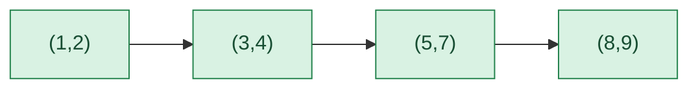

# Activity Selection

**Topic:** Greedy Algorithm

## Problem
Select the maximum number of non-overlapping activities, where each activity has a start time and a finish time.

## Greedy rule
Always choose the compatible activity that finishes earliest.

## Example

Input activities:

| Activity | Start | Finish |
|---|---:|---:|
| A0 | 1 | 2 |
| A1 | 3 | 4 |
| A2 | 0 | 6 |
| A3 | 5 | 7 |
| A4 | 8 | 9 |
| A5 | 5 | 9 |

### Sort by finish time

```text
(1,2) → (3,4) → (0,6) → (5,7) → (8,9) → (5,9)
```

### Selection



| Activity | Check | Decision |
|---|---|---|
| (1,2) | First activity | Select |
| (3,4) | 3 >= 2 | Select |
| (0,6) | 0 < 4 | Skip |
| (5,7) | 5 >= 4 | Select |
| (8,9) | 8 >= 7 | Select |
| (5,9) | 5 < 9 | Skip |

**Selected activities:** `(1,2), (3,4), (5,7), (8,9)`

## Key logic

1. Sort activities by finish time.
2. Select the first activity.
3. For each remaining activity, select it if `start >= lastSelected.finish`.
4. Update `lastSelected` whenever an activity is selected.

## Time Complexity
`O(n log n)`

## Space Complexity
`O(n)`
