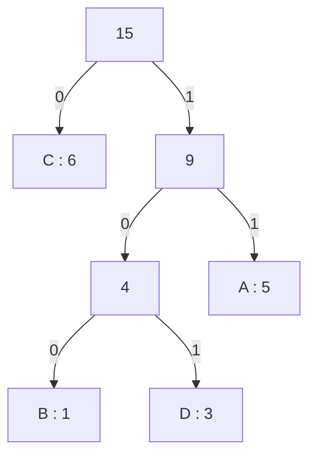
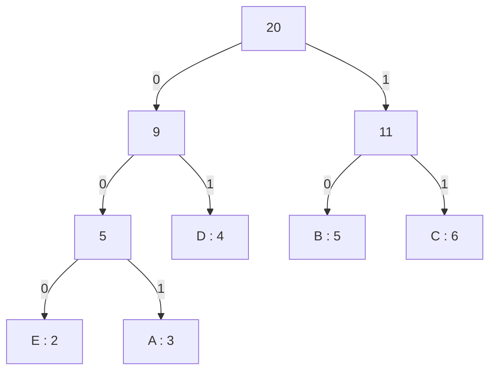

# Huffman Coding

- **Topic:** Greedy Algorithm
- **Supporting data structures:** Min Priority Queue (Heap), Binary Tree

## Approach
1. Arrange characters by increasing frequency (or insert them into a min-priority queue).
2. Remove the two nodes with the lowest frequencies.
3. Create a parent node whose frequency is their sum; attach the removed nodes as left and right children.
4. Insert the parent back into the queue.
5. Repeat until one root remains.
6. Traverse the tree: append `0` for a left edge and `1` for a right edge. A leaf's path is that character's Huffman code.

## Example 1 — Java implementation

Input frequencies:

| Character | Frequency |
|---|---:|
| A | 5 |
| B | 1 |
| C | 6 |
| D | 3 |

### Tree construction

The program combines the two nodes with the smallest frequencies:

1. `B(1) + D(3) = 4`
2. `4 + A(5) = 9`
3. `C(6) + 9 = 15` — the final root

### Final Huffman tree

A left edge adds `0`; a right edge adds `1`.



| Character | Huffman code |
|---|---|
| C | `0` |
| B | `100` |
| D | `101` |
| A | `11` |

## Example 2 — Message compression and storage calculation

Given the frequencies from the worked example in the notes:

| Character | Frequency | Huffman code | Code length |
|---|---:|---|---:|
| A | 3 | `001` | 3 |
| B | 5 | `10` | 2 |
| C | 6 | `11` | 2 |
| D | 4 | `01` | 2 |
| E | 2 | `000` | 3 |
| **Total** | **20** | | |

### Tree construction

Arrange the frequencies in increasing order: `E(2), A(3), D(4), B(5), C(6)`.

One valid sequence of merges is:

1. `E(2) + A(3) = 5`
2. `D(4) + 5 = 9`
3. `B(5) + C(6) = 11`
4. `9 + 11 = 20` — the root

### Huffman tree



The codes are obtained by following the path from the root to each character:

| Character | Path | Code |
|---|---|---|
| A | Left → Left → Right | `001` |
| B | Right → Left | `10` |
| C | Right → Right | `11` |
| D | Left → Right | `01` |
| E | Left → Left → Left | `000` |

### Compressed message size

Multiply each character's frequency by its code length:

```text
(A: 3 × 3) + (B: 5 × 2) + (C: 6 × 2)
+ (D: 4 × 2) + (E: 2 × 3)

= 9 + 10 + 12 + 8 + 6
= 45 bits
```

### Code table storage estimate

Using the simplified assumption in the notes that each character is stored using 8 bits:

- Character symbols: `5 × 8 = 40 bits`
- All Huffman codewords together: `3 + 2 + 2 + 2 + 3 = 12 bits`
- Estimated code table size: `40 + 12 = 52 bits`

### Total estimated storage

```text
Compressed message + code table
= 45 + 52
= 97 bits
```

For comparison, the original 20-character message takes `20 × 8 = 160 bits` under the same 8-bit-per-character assumption.

> The 52-bit code-table figure is the simplified estimate used in the notes. A real file must also represent enough information to identify codeword boundaries or reconstruct the Huffman tree; that metadata can add overhead. The exact codes can also vary when equal frequencies are resolved differently.

## Complexity
- **Time:** `O(n log n)` — each of the `n` nodes is inserted/removed from the priority queue a constant number of times.
- **Space:** `O(n)` — priority queue and Huffman tree.

## Key Observations
- Greedy choice: combine the two minimum-frequency nodes at every step.
- The priority queue keeps the smallest-frequency node accessible.
- Characters with higher frequencies generally receive shorter codes.
- No code is a prefix of another code (prefix-free property).
- Huffman Coding is a greedy algorithm; the heap and binary tree are supporting data structures.
