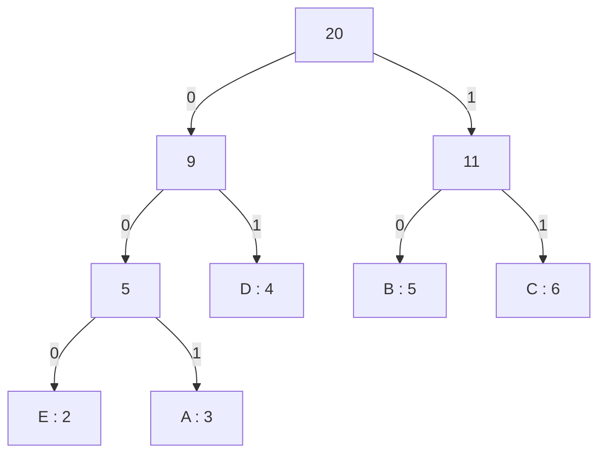

# Huffman Coding

**Topic:** Greedy Algorithm  
**Data structure:** Min Priority Queue (Heap)  
**Tree:** Binary Tree

## Basic steps
1. Arrange characters in increasing order of frequency.
2. Merge the two nodes with the smallest frequencies into a new parent node.
3. Reinsert the parent and repeat until one root remains.
4. Mark each left branch as `0` and each right branch as `1`.
5. A character's code is the path from the root to its leaf.

## Worked example

| Character | Frequency | Huffman code | Code length |
|---|---:|---|---:|
| A | 3 | `001` | 3 |
| B | 5 | `10` | 2 |
| C | 6 | `11` | 2 |
| D | 4 | `01` | 2 |
| E | 2 | `000` | 3 |
| **Total** | **20** | | |

### Merging steps

Arrange by increasing frequency: `E(2), A(3), D(4), B(5), C(6)`.

1. `E(2) + A(3) = 5`
2. `D(4) + 5 = 9`
3. `B(5) + C(6) = 11`
4. `9 + 11 = 20` (root)

### Huffman tree



### Compressed message size

Multiply each character's frequency by its code length:

```text
(A: 3 × 3) + (B: 5 × 2) + (C: 6 × 2)
+ (D: 4 × 2) + (E: 2 × 3)

= 9 + 10 + 12 + 8 + 6
= 45 bits
```

### Code table storage

Assuming each character symbol is stored using 8 bits:

- Character symbols: `5 × 8 = 40 bits`
- Huffman codewords: `3 + 2 + 2 + 2 + 3 = 12 bits`
- Code table: `40 + 12 = 52 bits`

### Total estimated storage

```text
Compressed message + code table
= 45 + 52
= 97 bits
```
