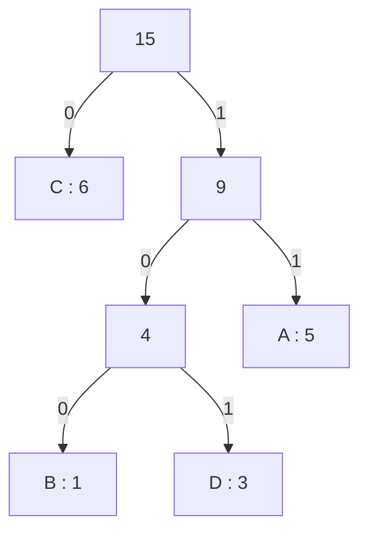

# Huffman Coding

- **Topic:** Greedy Algorithm
- **Supporting data structures:** Min Priority Queue (Heap), Binary Tree

## Approach
1. Insert each character as a leaf node into a min-priority queue using its frequency.
2. Remove the two nodes with the lowest frequencies.
3. Create a parent node whose frequency is their sum; attach the removed nodes as left and right children.
4. Insert the parent back into the queue.
5. Repeat until one root remains.
6. Traverse the tree: append `0` for a left edge and `1` for a right edge. A leaf's path is that character's Huffman code.

## Example

Input frequencies:

| Character | Frequency |
|---|---:|
| A | 5 |
| B | 1 |
| C | 6 |
| D | 3 |

### Tree construction

The program repeatedly combines the two nodes with the smallest frequencies:

1. `B(1) + D(3) = 4`
2. `4 + A(5) = 9`
3. `C(6) + 9 = 15` — the final root

### Final Huffman tree

A left edge adds `0`; a right edge adds `1`.

Read the bits along the path from the root to each character (leaf):

| Character | Path | Huffman code |
|---|---|---|
| C | Left | `0` |
| B | Right → Left → Left | `100` |
| D | Right → Left → Right | `101` |
| A | Right → Right | `11` |

> Huffman codes are variable-length and prefix-free. Different tie choices can produce different, but equally optimal, codes when frequencies are tied.

## Complexity
- **Time:** `O(n log n)` — each of the `n` nodes is inserted/removed from the priority queue a constant number of times.
- **Space:** `O(n)` — priority queue and Huffman tree.

## Key Observations
- Greedy choice: combine the two minimum-frequency nodes at every step.
- The priority queue keeps the smallest-frequency node accessible.
- Characters with higher frequencies generally receive shorter codes.
- No code is a prefix of another code.
- Huffman Coding is a greedy algorithm; the heap and binary tree are supporting data structures.
